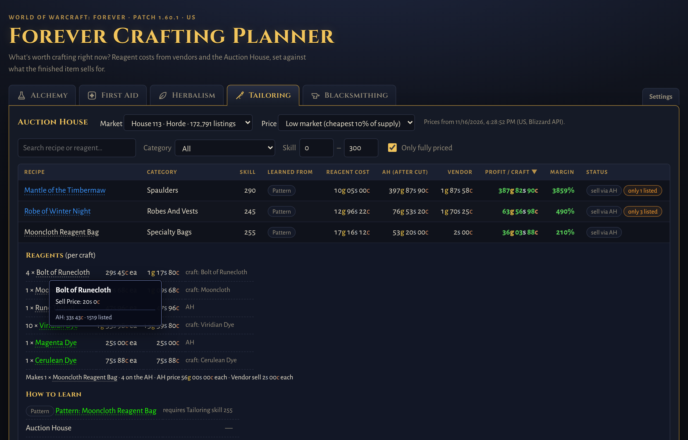

# Forever Crafting Planner

A fan-made profit planner for **World of Warcraft: Forever**. Pick a profession, and it shows what each recipe costs to craft (reagents from vendors or the Auction House) against what the finished item sells for. You can also see how each recipe is learned and at what skill.



## Use it

Open `index.html` in a browser. Everything is in that one file, and nothing to install. If the repo has GitHub Pages turned on, the same page is live at the Pages URL.

- **Profession tabs:** Alchemy, First Aid, Herbalism, Tailoring, Blacksmithing
- **Auction House:** choose a market (US Horde houses) and a price: *low market* (the price of the cheapest 10% of what's listed), *median*, or *lowest listing*
- **Click a recipe** to see each reagent's cost and where the price comes from (AH, vendor, or cheaper to craft), how to learn the recipe, and its skill-up colors
- **Hover an item** for an in-game style tooltip with its stats, effects, sell price, current AH price, and how many are listed
- **Thin markets** are flagged when 3 or fewer of an item are listed, since one listing can make a profit look much bigger than it is
- **Settings:** AH cut, "I gather my own herbs", and backup

Prices are a snapshot taken when the page was built. See below to refresh them.

## Refresh the data

You need Python 3 (no extra packages) and a free Blizzard API client.

1. Create a client at <https://develop.battle.net/access/clients>.
2. Save its keys in `blizzard_credentials.json` in this folder. `.gitignore` keeps this file out of the repo:
   ```json
   {"client_id": "YOUR_CLIENT_ID", "client_secret": "YOUR_CLIENT_SECRET"}
   ```
3. Run the scripts you need:

```bash
python3 tools/fetch_ah_prices.py --house 113   # AH prices for one house -> data/ah-snapshot-house113.json
python3 tools/fetch_ah_prices.py --list-houses # show all house IDs
python3 tools/fetch_forever_recipes.py         # recipes, items, vendor prices, tooltips (run after a patch)
python3 tools/fetch_seemeta_skills.py          # skill-up colors and sources
python3 tools/build_page.py                    # put the data into index.html
```

`fetch_ah_prices.py` takes `--region us|eu`, `--ruleset pvp|normal|rp|rppvp` and `--faction horde|alliance|blackwater`. `build_page.py --houses 113 114 120 124` chooses which snapshots appear in the market picker.

## Where the data comes from

| Data | Source |
|---|---|
| Recipes, reagents, items, tooltips, vendor prices | Blizzard Game Data API, `static-forever-*` namespace |
| Auction House listings | Blizzard Game Data API, `dynamic-forever-*`, `/data/wow/ruleset/{id}/auctions/{house}` (community-discovered, unofficial) |
| Skill from patterns, plans and recipe items | Blizzard Game Data API (the recipe item's "Requires …" line) |
| Skill-up colors, "learned automatically" | seemeta.com Forever profession pages |
| Alchemy trainer skills and recipe sources | Wowhead Forever pages, copied in by hand (`data/wowhead_*.json`) |
| Classic skill levels used for estimates | `wow-classic-items` npm package (`data/classic_skills.json`) |

### How accurate is it?

- **841 of 1,031 recipes** have their exact Forever skill.
- **Tailoring and Blacksmithing trainer recipes** show an estimate marked **≈**. Forever lowered these professions' skill requirements compared with Classic (Blacksmithing is mostly Classic − 25, Tailoring mostly Classic − 35). The planner converts the Classic skill to that scale and caps it at the exact yellow skill-up. Tested on recipes with a known skill, it's exact for 92% of Blacksmithing and 61% of Tailoring.
- **Training costs** aren't in any source this project can read, so they're blank.
- **AH prices are asking prices, not sales.** Gear with random bonuses ("of the Bear") is pooled per item.
- **Which house is which server type isn't published.** The API exposes 5 markets (each an Alliance, Horde and Blackwater house) but doesn't say which ruleset each belongs to.

## Project layout

```
index.html        the planner (data embedded; open it directly)
data/             recipe, item, skill and AH snapshot data
tools/            Python scripts that fetch data and rebuild index.html
docs/             screenshot
```

## Disclaimer

Fan-made and unofficial. Not affiliated with or endorsed by Blizzard Entertainment. World of Warcraft and Blizzard Entertainment are trademarks or registered trademarks of Blizzard Entertainment, Inc. Game data is from Blizzard's public Game Data API and is subject to Blizzard's API terms.
